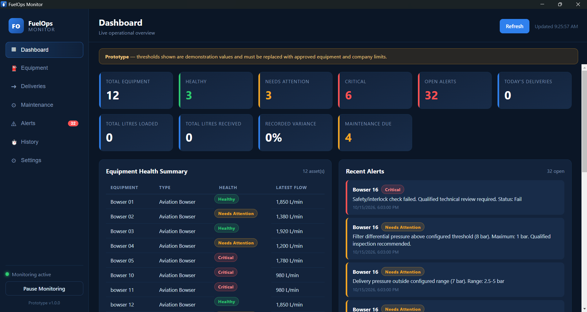

# FuelOps Monitor

A Windows desktop monitoring **prototype** for fuel operations covering:

- aviation fuel bowsers
- diesel / AGO peddlers
- fuel deliveries and haulage
- maintenance
- alerts

FuelOps Monitor watches Excel workbooks (or accepts manual entries), applies
monitoring rules, stores everything locally as JSON, and surfaces the results in
a dashboard with Windows notifications and a system-tray monitor.

> **Prototype notice**
> All thresholds shipped with this app are **demonstration values only**. They
> must be replaced with approved equipment manufacturer limits and company
> procedures before any operational use.

---

## Screenshots



---

## Workflow

```
Equipment / Operator data
        |
      Excel files
        |
    Excel watcher  (chokidar)
        |
   FuelOps backend  (monitoring rules)
        |
  Local storage  (storage/app-data.json)
        |
 Dashboard + Windows notification
```

Manual entry inside the app writes to the same Excel workbooks, so both
pathways share one source of truth.

---

## Technology

Electron, Node.js, vanilla HTML/CSS/JavaScript, `xlsx`, `chokidar`, local JSON
persistence, Electron Notification API, Electron Tray, `electron-builder`.

No React/Vue/Angular, no TypeScript, no cloud backend, no SQLite native modules.

---

## Install

Requires Node.js 18+ and npm.

```bash
cd dashboard
npm install
```

## Start

```bash
npm start
```

The app opens the dashboard, starts the Excel watcher, and stays alive in the
system tray when the window is closed.

---

## Pages

1. **Dashboard** – KPI cards (total equipment, healthy, needs attention,
   critical, open alerts, today's deliveries, litres loaded/received, recorded
   variance, maintenance due), equipment health summary, recent alerts, recent
   deliveries, maintenance due soon.
2. **Equipment** – per-asset cards (flow, pressure, filter dP, water, interlock,
   operating hours, days to service). Click a card for latest readings, history,
   alerts, recurring issues, maintenance history and trend warnings. Supports
   manual readings.
3. **Deliveries** – trip reconciliation table with variance and seal/delay
   status; abnormal rows highlighted. Supports manual deliveries.
4. **Maintenance** – fault, downtime, action, status, next service and recurring
   fault flags. Supports manual maintenance entries.
5. **Alerts** – open / investigating / resolved alerts. Resolving an alert
   captures root cause, action taken and resolution notes.
6. **History** – filter readings, deliveries, maintenance and alerts by
   equipment, date range, status, transporter and severity, with CSV export.
7. **Settings** – edit all demo thresholds (persisted).

---

## Excel automation

Watched files. In development they are in `dashboard/data/`; in the packaged /
portable build they are in a `FuelOps Monitor` folder on your **Desktop**
(`Desktop\FuelOps Monitor\data`).

| File | Purpose |
| --- | --- |
| `Bowser_Readings.xlsx` | Equipment / bowser readings |
| `Peddler_Deliveries.xlsx` | Delivery and haulage trips |
| `Maintenance_Log.xlsx` | Maintenance and fault history |

When you save a workbook the watcher:

1. waits for the write to finish (`awaitWriteFinish`)
2. reads the workbook
3. parses new rows
4. validates and skips invalid/blank rows
5. de-duplicates already-seen rows
6. persists to `storage/app-data.json`
7. runs the monitoring rules
8. creates alerts
9. notifies the renderer (no manual refresh needed)
10. shows a Windows notification when the result is abnormal

Missing workbooks are created automatically with sample rows on first run.

### Required columns

Column matching is tolerant — the short aliases in brackets are also accepted.

**Bowser_Readings.xlsx** — `Timestamp`, `Equipment ID` [`Equipment`],
`Equipment Type` [`Type`], `Flow Rate L/min` [`Flow Rate`],
`Delivery Pressure bar` [`Pressure`], `Filter dP bar` [`Filter dP`],
`Water Check` [`Water`], `Interlock Status` [`Interlock`],
`Operating Hours`, `Days Until Service`, `Notes`

**Peddler_Deliveries.xlsx** — `Timestamp`, `Trip ID`, `Equipment ID`,
`Transporter`, `Truck Number`, `Driver`, `Route`, `Quantity Loaded L`,
`Quantity Received L`, `Seal Status`, `Transit Delay Hrs`, `Notes`

**Maintenance_Log.xlsx** — `Date`, `Equipment ID`, `Equipment Type`,
`Fault Category`, `Fault Description`, `Downtime Hours`, `Action Taken`,
`Technician`, `Status`, `Next Service Date`, `Notes`

### Trigger a test alert

1. With the app running, open `data/Bowser_Readings.xlsx`.
2. Add a row, for example:
   `2026-10-15 15:00 | Bowser 09 | Aviation Bowser | 900 | 3.6 | 1.40 | Clear | Pass | 500 | 20 | test`
3. Save. The app imports it automatically and raises a **Needs Attention** alert
   for low flow and high filter dP, plus a Windows notification.
4. Drop the `Water Check` value to `Detected` to raise a **Critical** alert.

---

## Monitoring rules

| Condition | Result |
| --- | --- |
| Flow below minimum | Needs Attention |
| Pressure outside range | Needs Attention |
| Filter dP above maximum | Needs Attention |
| Water detected / alarm / fail | Critical |
| Interlock fail | Critical |
| Service due soon | Needs Attention |
| Service overdue | Critical |
| Delivery variance above threshold | Review Required |
| Seal not Intact | Review Required |
| Delay above threshold | Review Required |
| Same fault category 3+ times | Recurring Issue |

Trend logic (no machine learning):

- same fault category 3+ times -> **Recurring Issue**
- filter dP rising across the last 3 readings -> **Rising filter dP trend**
- flow declining across the last 3 readings -> **Declining flow trend**

Delivery variance is **never** labelled as theft; it is shown as
"Reconciliation required".

### Default (demo) thresholds

| Setting | Default |
| --- | --- |
| Minimum flow | 1500 L/min |
| Minimum pressure | 2.5 bar |
| Maximum pressure | 5.0 bar |
| Maximum filter dP | 1.0 bar |
| Service warning | 14 days |
| Delivery variance | 0.5 % |
| Delay threshold | 2 hours |

Edit them on the **Settings** page. Real limits must come from the equipment
manufacturer, approved company procedures, and qualified aviation/fuel
personnel.

---

## Windows notifications

Notifications are raised only for **Needs Attention**, **Critical**,
**Review Required** and **Recurring Issue** results. Examples:

```
FuelOps Monitor — Bowser 02
Filter differential pressure above configured threshold.
```

```
FuelOps Monitor — TRP-002
Delivery variance is 3.00%. Reconciliation required.
```

---

## System tray

Closing the main window **hides** the app; monitoring keeps running. The tray
menu provides:

- Open FuelOps Monitor
- Pause Monitoring
- Resume Monitoring
- Exit

Only **Exit** terminates the app.

---

## Local storage

`storage/app-data.json` holds equipment, deliveries, maintenance, alerts,
settings, processed-record keys and alert resolutions. If the file is missing it
is recreated; if it is corrupt the app falls back to safe defaults.

In the portable / packaged build, `data` and `storage` live in a
`FuelOps Monitor` folder on your **Desktop**, next to the app, so the Excel
workbooks are easy to find and edit. (Development keeps them in the project
folder.)

---

## Build

```bash
npm run build
```

On Windows this produces a portable executable in `dist/`
(`FuelOps-Monitor-1.0.0-portable.exe`) with the FuelOps icon and metadata. The
build is configured in `package.json`.

Building the Windows target from Linux/macOS requires Wine (used to edit the
executable icon and metadata). When Wine is not available, use the Wine-free
cross-build helper, which produces the portable executable with the default
Electron icon:

```bash
npm run build:win:cross
```

`npm run build:win` is an explicit Windows-only target alias.

---

## Error handling

The app is designed not to crash when:

- Excel is temporarily locked or being written
- Excel is empty or a sheet is missing
- a column is missing (aliases and blanks are tolerated)
- a row has invalid data (the row is skipped and logged)
- JSON storage is missing or corrupt
- Excel creates temporary files
- values are blank (no false alerts) or loaded quantity is zero (variance is
  reported as unavailable, not as an error)

Errors are logged to the terminal and user-friendly messages are shown in the
UI.

---

## Security

- `contextIsolation: true`, `nodeIntegration: false`
- `preload.js` exposes a small API through `contextBridge`
- all privileged work uses `ipcMain.handle` / `ipcRenderer.invoke`
- the renderer never accesses Node.js directly

---

## Current limitations

- Thresholds are demonstration values, not certified limits.
- Only the first worksheet of each workbook is read.
- Dates are parsed best-effort; ambiguous formats fall back to the raw string.
- Notifications use the default Electron icon sizing; rich toast actions are
  not implemented.
- No authentication, multi-user roles or audit signing.
- History filtering and CSV export operate on the local JSON store only.
- Trained analytics / machine learning are intentionally not implemented yet.
